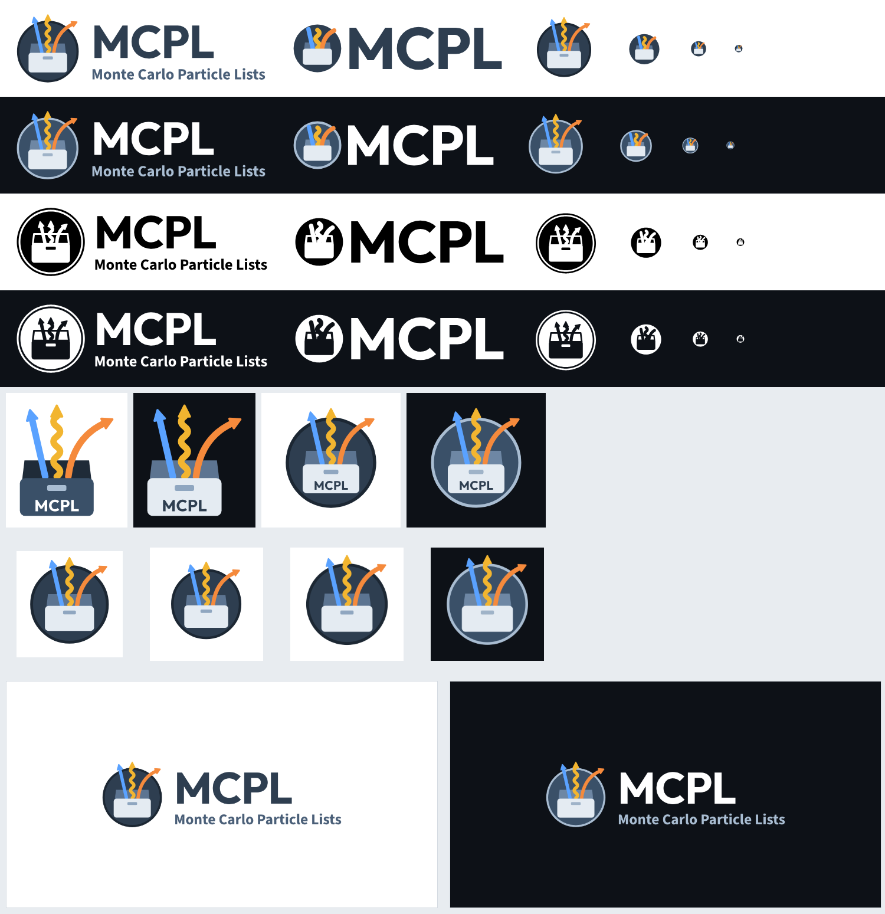
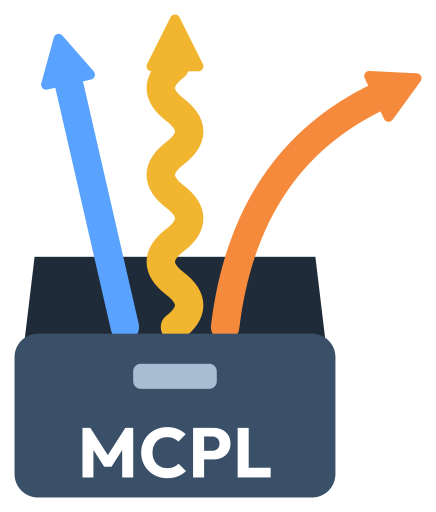
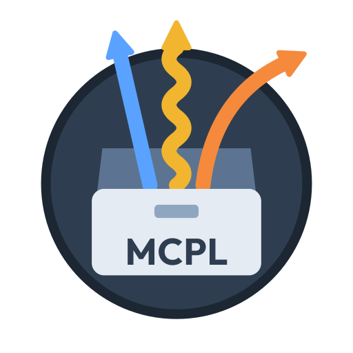

<p align="center">
  <picture>
    <source media="(prefers-color-scheme: dark)" srcset="svg/mcpl-logo-dark.svg">
    
  </picture>
</p>

# MCPL logo

The official logo of [MCPL](https://github.com/mctools/mcpl) (Monte Carlo Particle Lists):
an open box, the MCPL file, with particles leaving it for the next simulation — a neutron
(blue), a photon (yellow, wavy) and an electron (orange).

All text is converted to outlines, so no fonts are needed to display any of the files.
Except where noted, backgrounds are transparent.



## Usage note

You are welcome to use the MCPL logo to refer to MCPL, for example in talks,
papers, posters, websites, and in software that reads or writes MCPL files. When doing so:

- Use the files as provided, scaled proportionally. Please don't alter the proportions,
  colours or arrangement of the logo, or combine it with other marks.
- Pick the variant that suits the background: the dark variants on dark backgrounds, the
  one-colour variants where colour isn't possible.
- Don't use the logo in a way that suggests MCPL or its developers endorse a product,
  service or organisation, unless they actually do.

## Variants

| Suffix | Use on | Example |
|---|---|---|
| *(none)* | light pages |  |
| `-dark` | dark pages (e.g. GitHub dark) | [mcpl-logo-dark.svg](svg/mcpl-logo-dark.svg) |
| `-mono-black` | one-colour print, light backgrounds |  |
| `-mono-white` | one colour on dark backgrounds, gradients or photos | [mcpl-logo-mono-white.svg](svg/mcpl-logo-mono-white.svg) |

The dark and white variants use white text, so they are hard to see on GitHub's light
theme; [preview.png](preview.png) shows them all on suitable backgrounds.

The one-colour versions are drawn in a single ink with the box, lid and tracks cut out, so
whatever is behind them (including gradients) shows through. To stay clean in one colour,
their tracks are shorter and stay inside the disc; at large sizes the disc also has a
thin outer ring.

## Shapes

| Shape | Files | Light version |
|---|---|---|
| **Logo**: icon, name and tagline | `mcpl-logo…` |  |
| **Compact logo**: icon and name, sized to sit inline in text | `mcpl-logo-compact…` |  |
| **Icon**: the disc alone, square | `mcpl-icon…` |  |
| **Slide illustrations**: the box marked "MCPL", for diagrams where other codes point arrows at it | `mcpl-illustration-…` |   |

The illustrations come as `box` (the box on its own) and `box-in-disc` (the logo with
"MCPL" on the box), each in a light and a `-dark` version. On dark backgrounds the box on
its own turns light, as in the logo. They are not substitutes for the logo, but pictures
of an MCPL file for use in slides and figures.

## Folders

| Folder | Contents |
|---|---|
| [`svg/`](svg/) | Vector master files: logo, compact logo and full-detail icon for every variant |
| [`svg/icon-small-sizes/`](svg/icon-small-sizes/) | The icon redrawn for small sizes (96 px and below) |
| [`svg/illustration/`](svg/illustration/) | The slide illustrations |
| [`pdf/`](pdf/), [`pdf/illustration/`](pdf/illustration/) | Vector PDFs of all of the above (for pdfLaTeX papers and Beamer) |
| [`png/icon/`](png/icon/) | Icon at 16, 24, 32, 48, 64, 96, 128, 180, 192, 256, 512, 1024, 2048 px |
| [`png/logo/`](png/logo/) | Logo at heights 64, 128, 256, 512, 1024, 2048 px |
| [`png/logo-compact/`](png/logo-compact/) | Compact logo at heights 24, 32, 48, 64, 128, 256, 512 px |
| [`png/illustration/`](png/illustration/) | Slide illustrations at heights 128, 256, 512, 1024, 2048 px |
| [`web/`](web/) | Favicons and app icons (see below) |
| [`social/`](social/) | Share images and avatars, on solid backgrounds |

**About the small sizes.** At 96 px and below the icon is simplified: the box is plain,
the tracks are thicker and have no arrowheads. In one colour, the small version is a solid
disc without the outer ring. Every PNG already uses the right version. If you scale an SVG
yourself, use the file from [`svg/icon-small-sizes/`](svg/icon-small-sizes/) for anything
below about 100 px. The compact logo always uses the small version, since it is meant to
be small.

| 16 px | 32 px | 64 px | 128 px | full detail |
|:-:|:-:|:-:|:-:|:-:|
|  |  |  |  |  |

Logo files are trimmed to the artwork with a ~2% margin; add clear space where you place them.

## Web

| File | Purpose |
|---|---|
| [`web/favicon.ico`](web/favicon.ico) | Classic favicon, contains 16, 32 and 48 px |
| [`web/favicon.svg`](web/favicon.svg) | Modern browsers; switches automatically between light and dark |
| [`web/apple-touch-icon.png`](web/apple-touch-icon.png) | iPhone/iPad home screen, 180 px, white background |
| [`web/android-chrome-192x192.png`](web/android-chrome-192x192.png), [`-512x512`](web/android-chrome-512x512.png) | Android / web app manifest |
| [`web/maskable-icon-192x192.png`](web/maskable-icon-192x192.png), [`-512x512`](web/maskable-icon-512x512.png) | Android adaptive icon (safe-zone padding, white background) |

```html
<link rel="icon" href="/favicon.ico" sizes="48x48">
<link rel="icon" href="/favicon.svg" type="image/svg+xml">
<link rel="apple-touch-icon" href="/apple-touch-icon.png">
<link rel="manifest" href="/site.webmanifest">
```

```json
{
  "name": "MCPL",
  "icons": [
    { "src": "/android-chrome-192x192.png", "sizes": "192x192", "type": "image/png" },
    { "src": "/android-chrome-512x512.png", "sizes": "512x512", "type": "image/png" },
    { "src": "/maskable-icon-512x512.png", "sizes": "512x512", "type": "image/png", "purpose": "maskable" }
  ]
}
```

## Social

| File | Purpose |
|---|---|
| [`social/github-social-preview-1280x640.png`](social/github-social-preview-1280x640.png) (+ [`-dark`](social/github-social-preview-dark-1280x640.png)) | GitHub repository → Settings → Social preview |
| [`social/share-image-1200x630.png`](social/share-image-1200x630.png) (+ [`-dark`](social/share-image-dark-1200x630.png)) | Open Graph / link previews on other sites |
| [`social/avatar-1024.png`](social/avatar-1024.png) (+ [`-dark`](social/avatar-dark-1024.png)) | Square avatar, e.g. a GitHub organisation |

## Snippets

A README logo that follows the reader's light or dark theme. Within this repository use
relative paths as here; from another repository, use the files' "raw" URLs, i.e.
`https://raw.githubusercontent.com/<owner>/<repo>/<branch>/svg/mcpl-logo.svg`.

```html
<picture>
  <source media="(prefers-color-scheme: dark)" srcset="svg/mcpl-logo-dark.svg">
  
</picture>
```

The compact logo inline in HTML text, sized so "MCPL" matches the surrounding text and
sits on its baseline:

```html
… stored in  files …
```

LaTeX (inline, roughly matching the text):

```latex
\raisebox{-0.069em}{\includegraphics[height=0.844em]{mcpl-logo-compact.pdf}}
```

These numbers are for the light and one-colour compact logos. The dark one is slightly
taller because of its rim: use `height:0.887em; vertical-align:-0.090em`.

## Colours

| | Light | Dark |
|---|---|---|
| Disc | `#2E3E50` | `#3A5068` |
| Disc rim | `#1C2733` | `#A9BDD2` |
| Lid, inside | `#5C7491` | `#6E87A4` |
| Box | `#E4EBF2` | `#E4EBF2` |
| Latch | `#8FA6C0` | `#9FB3C8` |
| Neutron track | `#5AA2FF` | `#5AA2FF` |
| Photon track | `#F2B530` | `#F2B530` |
| Electron track | `#F58A3C` | `#F58A3C` |
| "MCPL" | `#2E3E50` | `#FFFFFF` |
| Tagline | `#4A5F78` | `#A9BDD2` |

The box illustration on light backgrounds uses `#3A5068` for the box, `#1F2B38` for the
inside of the lid, `#A9BDD2` for the latch and white for "MCPL". One-colour versions use
pure `#000000` or `#FFFFFF`.

## Typefaces

"MCPL" is set in **Outfit Bold** (Copyright 2021 The Outfit Project Authors); the tagline is
**Source Sans 3 Bold** (Copyright 2010–2020 Adobe, with Reserved Font Name "Source"). Both
are licensed under the [SIL Open Font License 1.1](https://openfontlicense.org) (OFL).
These are the same typefaces as in the [NCrystal](https://github.com/mctools/ncrystal) logo.

- **The logo files contain no fonts.** All letters were converted to plain vector shapes,
  so these files do not distribute font software, and the OFL's conditions do not apply
  to them.
- **Use is unrestricted.** The OFL allows the fonts to be used for any purpose, including
  logos and commercial work, with no fee and no attribution required in the artwork.
- **The OFL's restrictions only concern the font files themselves:** they may not be sold
  on their own; a modified font must not use the original name (for Source Sans 3, "Source"
  is a reserved name and an Adobe trademark); and if the font files are redistributed, the
  licence text must accompany them.
- **To recreate or edit the logo text**, get the fonts from Google Fonts:
  [Outfit](https://fonts.google.com/specimen/Outfit) and
  [Source Sans 3](https://fonts.google.com/specimen/Source+Sans+3).

## License

The files in this repository are licensed under the [Apache License 2.0](LICENSE).
As stated in its section 6, that licence does not grant permission to use the MCPL
name or logo as a trademark beyond what is needed to describe the origin of the work;
the [usage note](#usage-note) above describes how the project would like the logo used.
